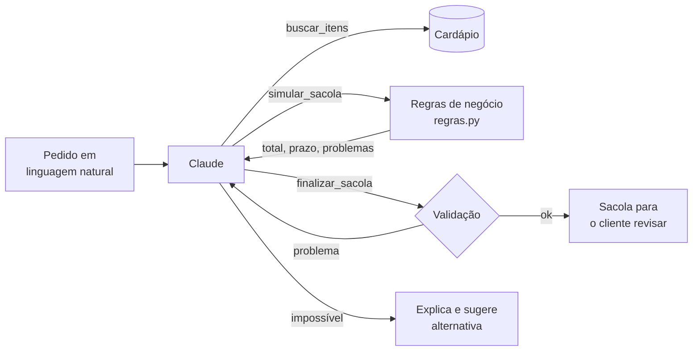

# Sacola Multi-loja

[](https://github.com/Luizamiller/sacola-multiloja/actions/workflows/testes.yml)

Estudo de produto + protótipo navegável para um app de delivery: uma sacola que aceita itens de **várias lojas ao mesmo tempo**, com **entrega combinada** para lojas próximas e **pratos favoritos** reutilizáveis.

> Projeto conceitual de portfólio, sem vínculo com nenhuma empresa. Lojas, preços e distâncias são fictícios.

**▶️ [Ver o protótipo no ar](https://luizamiller.github.io/sacola-multiloja/)** (GitHub Pages)

## O problema

Em apps de delivery, a sacola costuma aceitar apenas uma loja. Ao adicionar um item de outra loja, o usuário precisa descartar a sacola atual ou desistir do novo item. Isso gera:

- dois checkouts para um pedido que, na cabeça do usuário, é um só (almoço + sobremesa, refeição + farmácia);
- perda de itens escolhidos com calma;
- nenhum lugar para guardar **pratos** (não só restaurantes) que a pessoa pede sempre.

## A solução

| Hoje | Proposta |
|---|---|
| 1 loja por sacola | Sacola agrupada por loja (até 4) |
| Trocar de loja apaga a sacola | Itens de lojas diferentes convivem |
| Favoritos só de restaurantes | Pratos favoritos + listas salvas ("Sexta de sempre") |
| Uma taxa por pedido | Entrega combinada para lojas a até 2 km |

Pagamento único; cada loja recebe só o seu pedido, então a operação do restaurante não muda.

## Regras de negócio

- **Limite:** até 4 lojas por sacola.
- **Pedido mínimo:** vale por loja; o checkout fica bloqueado até ajustar.
- **Agrupamento:** lojas a ≤ 2 km entre si formam um grupo (componentes conectados num grafo de distâncias).
- **Taxa combinada:** `max(taxas) + 1,99 × (n − 1)`
- **Prazo combinado:** `max(prazos) + 5 min × (n − 1)` — o usuário pode separar o grupo se tiver pressa.
- **Cupom:** por loja.
- **Cancelamento parcial:** se uma loja recusar, só aquele pedido é estornado.

## Assistente de pedido com IA

O cliente escreve o que quer — *"jantar para 3 com sobremesa, até R$ 130"* — e um agente com o **Claude** monta a sacola multi-loja, pronta para revisão. Código em [`assistente/`](assistente/).



**Decisões de projeto**

- **O LLM escolhe, o código calcula.** Preço, taxa combinada, prazo e pedido mínimo saem de `regras.py` — a mesma lógica do protótipo. O modelo nunca faz conta de cabeça.
- **Ferramentas em vez de cardápio no prompt.** O modelo consulta o cardápio por `buscar_itens` e só pode usar o que vem de lá. Item inventado é barrado.
- **Validação antes de entregar.** `finalizar_sacola` confere tudo de novo. Se a sacola estourar o orçamento, ficar abaixo do mínimo ou passar de 4 lojas, ela é **rejeitada** e o motivo volta para o modelo corrigir.
- **Pode dizer "não dá".** "Pizza para 3" ou "jantar para 3 por R$ 60" não viram uma sacola qualquer: o assistente explica e sugere a alternativa mais próxima.
- **Custo previsível.** Limite de 10 chamadas por pedido e contagem de tokens em cada execução.

**Avaliação.** [`casos.json`](assistente/casos.json) tem 12 pedidos com as restrições reais de cada um (orçamento, nº de pratos, sobremesa, vegetariano, itens obrigatórios), incluindo 4 impossíveis. A nota é dada **por código, não por outro LLM**, e um teste confere por força bruta que o gabarito está certo (o que está marcado como impossível é impossível de verdade).

| Métrica | Resultado |
|---|---|
| Casos atendidos corretamente | _a medir_ |
| Sacolas barradas pela validação | _a medir_ |
| Chamadas ao modelo por pedido (média) | _a medir_ |
| Tokens por pedido (média) | _a medir_ |

**Como rodar**

```bash
cd assistente
pip install -r requirements.txt
pytest -q                                   # testes, sem chave de API
export ANTHROPIC_API_KEY=...
python agente.py "jantar para 3 com sobremesa, até R$ 130"
python avaliar.py                           # roda os 12 casos e salva em reports/
```

**Próximos passos:** usar favoritos e listas salvas como contexto ("o de sempre, mas para 4") e levar o assistente para dentro do protótipo.

## Métricas

- Abandono ao trocar de loja
- Ticket médio
- Taxa de uso da entrega combinada
- Recompra via listas salvas

Riscos: prazo maior em entregas combinadas, cancelamentos parciais, complexidade logística para o entregador.

## Protótipo

`index.html` é um único arquivo (HTML + CSS + JavaScript puro, sem dependências). Para rodar, basta abrir no navegador.

Dá para:
- navegar pelas lojas e adicionar itens de lojas diferentes;
- favoritar pratos e repetir uma lista salva;
- ligar/desligar a entrega combinada e ver taxa, prazo e economia mudarem;
- ver o bloqueio de pedido mínimo por loja;
- finalizar com um pagamento que gera um pedido por loja.

## Estrutura do código

- `STORES` / `ITEMS`: dados fictícios (com coordenadas em km).
- `clusters()`: agrupa lojas por proximidade (BFS com limite de 2 km).
- `plan()`: calcula subtotais, taxas, prazos, economia e bloqueios.
- `render()`: desenha as três abas (Início, Favoritos, Sacola).

---
Autora: **Luiza Miller** · [LinkedIn](https://linkedin.com/in/luiza-miller)
