# UMAMI

> Antes chamado **Sacola Multi-loja**. A evolução para UMAMI está documentada em [`docs/umami/`](docs/umami/).

[](https://github.com/Luizamiller/umami/actions/workflows/testes.yml)

<p>
  <a href="https://luizamiller.github.io/umami/"></a>
  <a href="#como-rodar"></a>
</p>

**Acesso na demonstração:** Explore sem conta ou entre com `demo@umami.app` / `umami-demo-2026`; o código de verificação aparece na própria tela (caixa de testes: nenhuma mensagem é enviada de verdade).

UMAMI é um app de delivery cuja sacola aceita itens de **até quatro lojas**, com **entrega combinada** para lojas próximas, **pratos favoritos**, **listas salvas** e um **assistente** que monta a sacola a partir de um pedido em linguagem natural — sempre conferido por uma camada determinística de regras antes de chegar ao cliente.

> Projeto conceitual de portfólio, sem vínculo com nenhuma empresa. Lojas, preços e distâncias são fictícios. O pagamento é simulado.


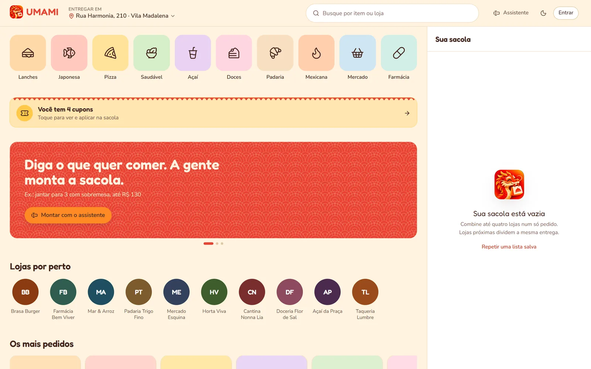

## Experimente

```bash
cd backend && uv sync && uv run alembic upgrade head && uv run python -m app.seed && uv run uvicorn app.main:app --port 8104
cd web && pnpm install && pnpm dev     # http://localhost:5104
```

Conta de demonstração: **demo@umami.app** ou **(11) 98888-0000**, senha **umami-demo-2026**. No modo de testes (padrão no desenvolvimento) nenhum WhatsApp ou e-mail é enviado: o código aparece na "caixa de testes" da tela de login. Telas, fluxos e limites em [`docs/umami/05-app-completo.md`](docs/umami/05-app-completo.md).

## O problema

Em apps de delivery, a sacola costuma aceitar uma loja só. Ao adicionar um item de outra loja, o usuário descarta a sacola ou desiste do item. O resultado: dois checkouts para o que, na cabeça de quem pede, é um pedido só (almoço + sobremesa, refeição + farmácia), itens perdidos e nenhum lugar para guardar **pratos** que se repetem.

| Hoje | Proposta |
|---|---|
| 1 loja por sacola | Sacola agrupada por loja (até 4) |
| Trocar de loja apaga a sacola | Itens de lojas diferentes convivem |
| Favoritos só de restaurantes | Pratos favoritos + listas salvas ("Sexta de sempre") |
| Uma taxa por pedido | Entrega combinada para lojas a até 2 km |

Pagamento único; cada loja recebe só o seu pedido, e a operação do restaurante não muda.

## Regras de negócio

Implementadas uma única vez em [`backend/app/rules.py`](backend/app/rules.py) — a interface, o checkout e o assistente usam a mesma função.

- **Limite:** até 4 lojas por sacola.
- **Pedido mínimo:** por loja; o checkout fica bloqueado até ajustar.
- **Agrupamento:** lojas a ≤ 2 km entre si formam um grupo (componentes conectados num grafo de distâncias).
- **Taxa combinada:** `max(taxas) + 1,99 × (n − 1)` · **prazo combinado:** `max(prazos) + 5 min × (n − 1)`.
- **Separar uma loja:** o cliente pode tirar uma loja do grupo se tiver pressa; ela volta a pagar a própria taxa.
- **Disponibilidade:** item esgotado, loja fechada e loja fora da área de entrega bloqueiam o pedido.
- **Cancelamento parcial:** se uma loja recusa, só a parte dela é estornada — itens + a diferença na taxa do grupo.

## Assistente com validação determinística

O cliente escreve *"jantar para 3 com sobremesa, até R$ 130"* e recebe uma sacola pronta para revisar.

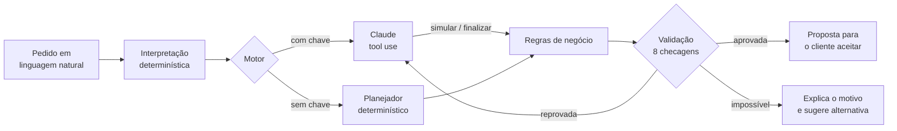

**Decisões de projeto**

- **O modelo escolhe, o código calcula.** Preço, taxa, prazo e pedido mínimo saem das regras. O modelo nunca faz conta de cabeça.
- **Ferramentas em vez de cardápio no prompt.** O Claude consulta o cardápio por `buscar_itens` e só pode usar o que vem de lá.
- **Validação dupla.** `finalizar_sacola` rejeita sacolas com problema e devolve o motivo para o modelo corrigir; depois, o serviço valida de novo com as restrições entendidas do texto (orçamento, itens citados, vegetariano) — mesmo que o modelo esqueça de passá-las.
- **Funciona sem chave de API.** Sem `ANTHROPIC_API_KEY`, um planejador determinístico monta a sacola mais barata (ou mais rápida) que passa nas mesmas regras. Se o Claude falhar, o serviço cai para ele e avisa.
- **Pode dizer "não dá".** Pedidos impossíveis não viram uma sacola qualquer: o assistente explica (orçamento, loja fechada, item esgotado, limite de lojas) e sugere a alternativa mais próxima.
- **Custo previsível.** Limite de 10 chamadas por pedido e contagem de tokens em cada execução.

## Avaliação

Nota dada **por código, não por outro LLM** ([`backend/app/eval.py`](backend/app/eval.py)).

| Suíte | Catálogo | Casos | Planejador determinístico |
|---|---|---|---|
| v1 — os 12 casos originais | original (4 lojas, 12 itens) | 12, 4 impossíveis | **12/12** |
| v2 — casos novos | ampliado (11 lojas, 34 itens) | 12, 5 impossíveis | **12/12** |

O gabarito também é testado: os casos impossíveis da v1 são confirmados por força bruta (como no projeto original), e cada impossível da v2 tem um motivo verificável de forma independente (limite inferior de custo, loja fechada, item esgotado, loja fora da área, número de lojas exigidas). A avaliação com o Claude roda com `uv run python -m app.eval --motor claude` quando há chave configurada.

## Arquitetura

```
umami/
├── backend/                 FastAPI · SQLAlchemy 2 · Alembic · SQLite (local) / Postgres (produção)
│   ├── app/
│   │   ├── rules.py         regras de negócio (fonte única de verdade)
│   │   ├── validation.py    validação determinística das propostas
│   │   ├── catalog.py       catálogo versionado (data/catalogo.json)
│   │   ├── assistant/       parser · planejador · agente Claude · serviço
│   │   ├── api/             rotas: catálogo, sacola, pedidos, favoritos, listas, assistente
│   │   ├── models.py        estado do usuário
│   │   └── eval.py          avaliação contra o gabarito
│   ├── alembic/             migrações
│   ├── data/                catálogo + casos_v1.json (originais) + casos_v2.json
│   └── tests/               54 testes (regras, parser, agente simulado, API ponta a ponta)
└── web/                     React 19 · TypeScript · Vite · Tailwind 4 · Radix · Motion · TanStack Query
    ├── src/components/      sacola, mapa do bairro, assistente, primitivos de UI
    ├── src/pages/           início, loja, checkout, pedidos, favoritos
    └── e2e/                 Playwright: fluxo de compra com o assistente
```

Decisões detalhadas em [`docs/ARQUITETURA.md`](docs/ARQUITETURA.md).

## Telas

Capturas no celular (390 px). O app também funciona no computador, com a sacola fixa ao lado.

<table>
<tr>
<td align="center" valign="top" width="33%"><br><sub>Abertura com o mascote</sub></td>
<td align="center" valign="top" width="33%">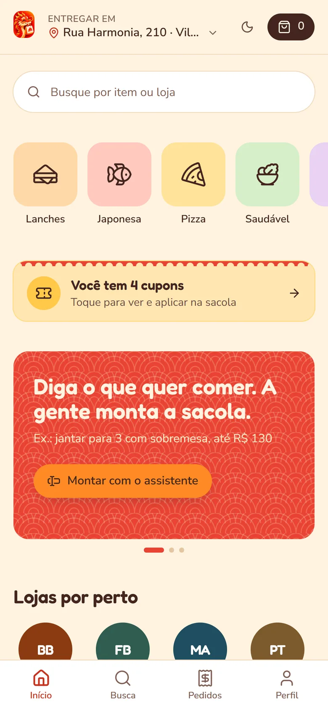<br><sub>Início: categorias, cupons, assistente e lojas por perto</sub></td>
<td align="center" valign="top" width="33%">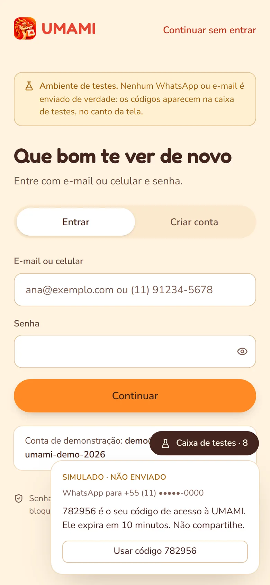<br><sub>Entrar com e-mail ou celular</sub></td>
</tr>
<tr>
<td align="center" valign="top" width="33%">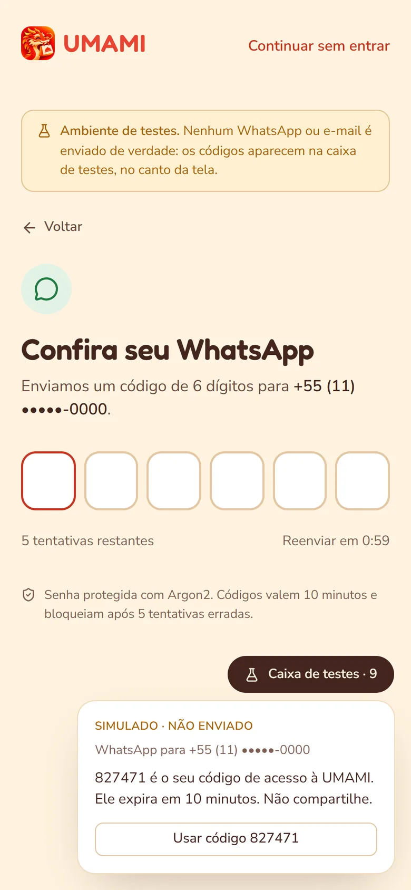<br><sub>Código de 6 dígitos (modo de testes: nada é enviado de verdade)</sub></td>
<td align="center" valign="top" width="33%">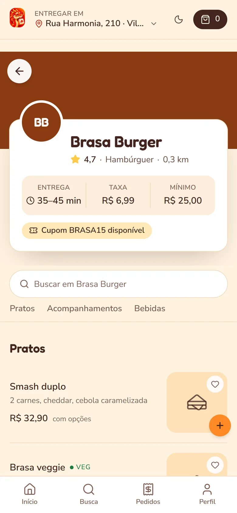<br><sub>Loja: tempo, taxa, mínimo, cupom e cardápio com abas</sub></td>
<td align="center" valign="top" width="33%">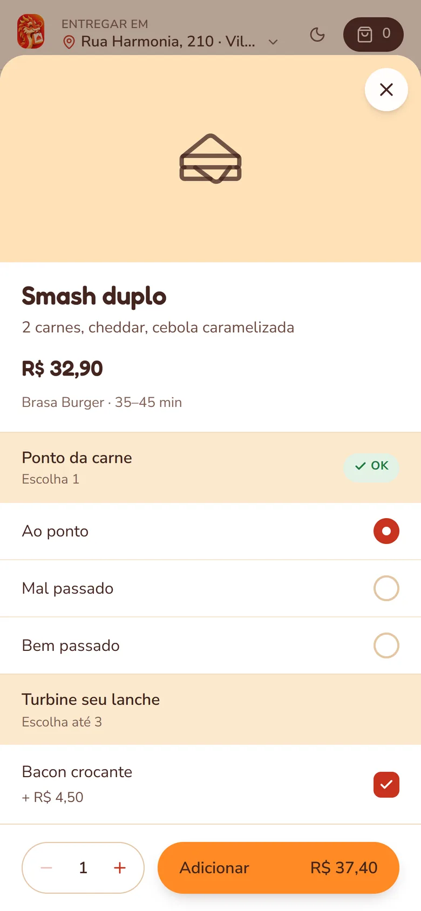<br><sub>Produto com opções obrigatórias e adicionais, preço ao vivo</sub></td>
</tr>
<tr>
<td align="center" valign="top" width="33%">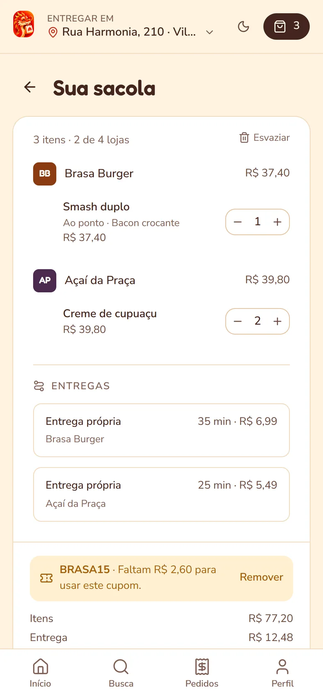<br><sub>Sacola com duas lojas, entregas e cupom com o motivo de não valer ainda</sub></td>
<td align="center" valign="top" width="33%">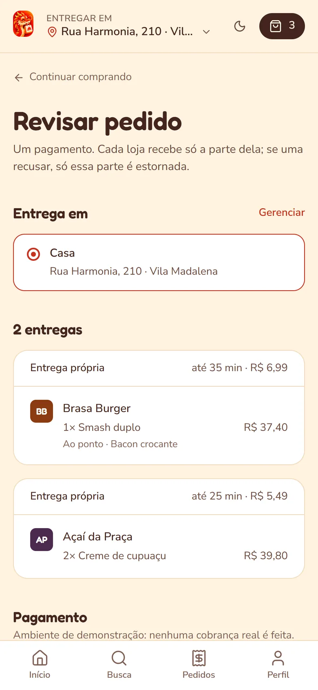<br><sub>Checkout: um pagamento, uma parte para cada loja</sub></td>
<td align="center" valign="top" width="33%">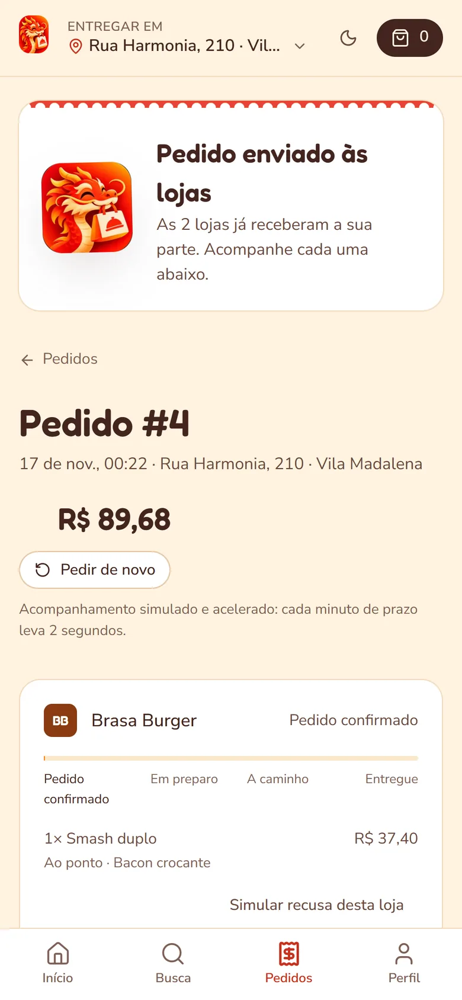<br><sub>Acompanhamento por loja, com estorno parcial na recusa</sub></td>
</tr>
<tr>
<td align="center" valign="top" width="33%">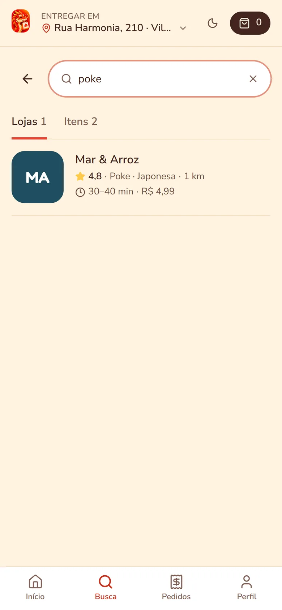<br><sub>Busca enquanto digita, por lojas e itens</sub></td>
<td align="center" valign="top" width="33%">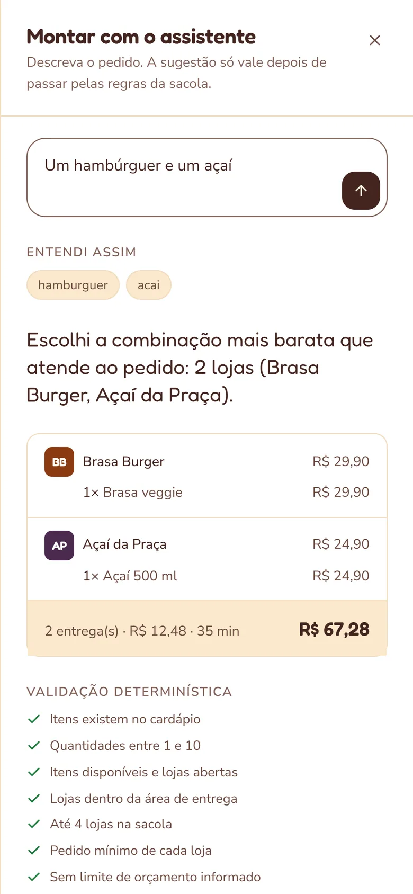<br><sub>Assistente: o pedido em linguagem natural passa por regras antes de virar sacola</sub></td>
<td align="center" valign="top" width="33%">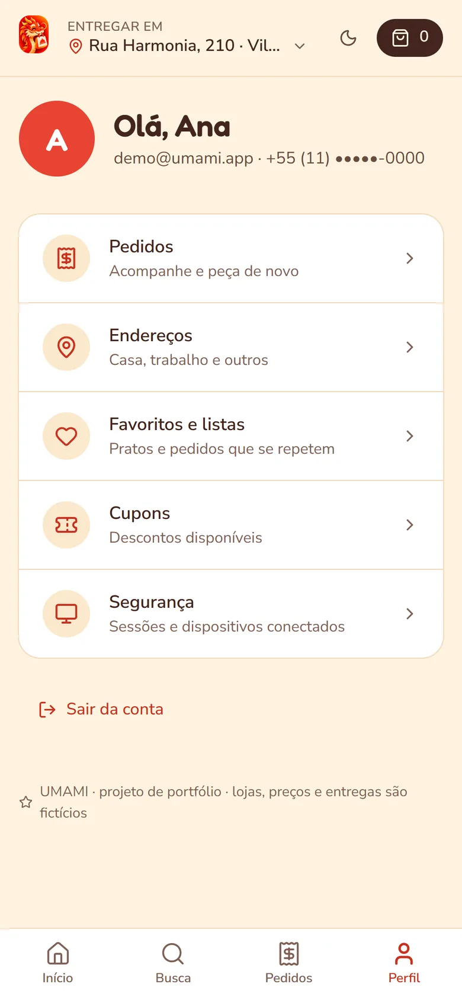<br><sub>Perfil: pedidos, endereços, favoritos, cupons e sessões</sub></td>
</tr>
</table>
## Demonstração online

<https://luizamiller.github.io/umami/> é um site estático no GitHub Pages, mas a lógica não foi reescrita: **o próprio backend FastAPI roda dentro do navegador**, no [Pyodide](https://pyodide.org) (Python em WebAssembly), num Web Worker. As chamadas a `/api` do frontend são desviadas para ele (`web/src/demo/`).

- Banco SQLite em memória, criado com os dados de exemplo a cada carregamento; recarregar a página volta tudo ao início.
- Sem servidor e sem chaves: o assistente usa o planejador determinístico.
- A primeira visita baixa o Python e as bibliotecas (alguns segundos); depois o navegador guarda em cache.
- Gerar de novo: `cd web && pnpm build:demo` (empacota o backend em `public/demo/backend.zip` e faz o build com a base do GitHub Pages).

## Como rodar

Pré-requisitos: Python 3.12 com [uv](https://docs.astral.sh/uv/) e Node 22 com pnpm.

```bash
cd backend
uv sync
uv run alembic upgrade head
uv run uvicorn app.main:app --port 8104
```

```bash
cd web
pnpm install
pnpm dev            # http://localhost:5104 (proxy de /api para a porta 8104)
```

Testes e avaliação:

```bash
cd backend && uv run pytest && uv run python -m app.eval
cd web && pnpm typecheck && pnpm test && pnpm build
cd web && PLAYWRIGHT_CHANNEL=msedge pnpm test:e2e   # usa o Edge instalado; no CI, o Chromium do Playwright
```

Produção (API servindo o build do frontend, com Postgres):

```bash
docker compose up --build    # http://localhost:8000
```

Para usar o Claude, copie `backend/.env.example` para `backend/.env` e preencha `ANTHROPIC_API_KEY`. A chave fica só no servidor.

## Limitações

- Catálogo, distâncias e acompanhamento do pedido são simulados; o acompanhamento é acelerado (1 min de prazo = 2 s).
- A sessão é anônima por cookie; não há contas de usuário nem pagamento real.
- O planejador determinístico é guloso, não um otimizador exato: a garantia de correção vem da validação, não dele. Ele pode, em casos raros, não achar uma combinação que existe.
- A avaliação com o Claude ainda não foi medida neste repositório (sem chave de API no ambiente de desenvolvimento).

## Outros projetos

- **Às Sábias Reflexões** — acervo do podcast com IA: do vídeo à transcrição, 8 peças revisadas e assistente com citações. [Demonstração](https://luizamiller.github.io/sabias-reflexoes-ia/) · [Código](https://github.com/Luizamiller/sabias-reflexoes-ia)
- **Fale com o Farmacêutico** — atendimento farmacêutico no delivery, com IA que sugere e o farmacêutico que decide. [Demonstração](https://luizamiller.github.io/fale-com-farmaceutico/) · [Código](https://github.com/Luizamiller/fale-com-farmaceutico)
- **Panorama Delivery** — análise de 406 mil restaurantes do iFood, transformada em plataforma interativa. [Demonstração](https://luizamiller.github.io/analise-restaurantes-ifood/) · [Código](https://github.com/Luizamiller/analise-restaurantes-ifood)

---
Autora: **Luiza Miller** · [LinkedIn](https://linkedin.com/in/luiza-miller)
